# Introduction

Figure 1 IDS logo

Intrusion Detection Systems (IDS) are sophisticated protective technologies used to monitor and analyze network traffic for possible threats or illicit activity. They play a key role in detecting cyber-attacks, breaches, and other harmful practices by comparing the system activities with a set of predefined conditions or rules (Scarfone & Mell, 2007). There are two main class types of Intrusion Detection System (IDS): Network-based IDS (NIDS), which analyzes traffic on a network, and Host-based IDS (HIDS), which monitors individual devices for signs of abnormal activity. An open-source IDS which can operate in multiple modes such as packet sniffing, logging, and real time intrusion detection is Snort (Roesch, 1999). Concerns surrounding the increasing number of cyber threats have given rise to the importance of IDS. An IDS can allow organizations to significantly improve their network security posture by detecting potential threats well in advance and minimizing the risk before any severe damage occurs.

## 1.1 Recent Challenges in IDS Deployment

Despite the critical role IDS plays in cybersecurity, it faces several deployment challenges that limit its efficiency in detecting modern cyber threats. Some of the most pressing issues include:

  - Advanced Persistent Threats: Even as attackers employ sophisticated strategies to avoid being detected, they can still commence their work using low and slow methods that resemble regular network traffic (Singh et al., 2022).

  - Encrypted Traffic Monitoring: Given that nearly 90% of network traffic is encrypted, Intrusion Detection Systems (IDS) face challenges in analysing data within TLS/SSL communications, permitting malware to evade detection (Rahman et al., 2021).

  - Increased False Positives and False Negatives: Through the use of Signature Intrusion Detection Systems, there is an increased incidence of false alarms making it more difficult for security experts to ascertain real threats from non-threatening activity (Hassan et al., 2023).

  - Cloud Security Issues: Conventional Intrusion Detection Systems (IDS) were developed for on-premise networks, complicating the security of cloud-based infrastructures without supplementary modifications (Chen et al., 2023).

  - Computationally Intensive Processing: Certain IDS systems necessitate substantial computational resources, which may impede network performance and induce bottlenecks (Kumar et al., 2022). 

  - Signature-Based Boundaries: A good number of modern Intrusion Detection Systems (IDS) are created with a dependency on signature detection making them useless against zero-day threats that have not been recorded in the signature files (Mohanakrishnan, 2022).

## 1.2 Addressing IDS Deployment Challenges with Snort

Besides many other issues, Snort as an open-source Intrusion Detection System (IDS) helps users automate and customize processing using external security products. Snort can be configured for cloud environments, allows behavioral detection of anomalies, and integrates with firewalls and SIEM systems for better incident response and forensic investigations (Caswell & Beale, 2021).

# 2.0 Vulnerabilities and Potential Attacks

## 2.1 How Attackers Exploit IDS Weaknesses

While IDS solutions enhance network security, adversaries continually devise methods to circumvent detection systems. The predominant techniques encompass:

  - Evasion Techniques: In some cases, evasive attackers employ packet-stuffing techniques using fragmented packets which make it impossible for the IDSs to accurately consider the traffic (Kumar et al., 2022).

  - Denial-of-Service (DoS) Attacks: Cybercriminals usually flood the Intrusion Detection System (IDS) with fake alerts until it reaches a state of oversaturation. This makes it impossible for the security teams to verify real threats against the system (Chen et al., 2023).

  - Polymorphic Malware: Several malware types aim to and are capable of changing their programming code in order to bypass being detected via signature detection methods. This makes it harder for most IDS systems like Snort to flag them as threats (Hassan et al., 2023).

  - Insider Threats: Malicious insiders may deactivate IDS setups or alter security protocols to permit unauthorized access (Singh et al., 2022).

## 2.2 Case Study: Colonial Pipeline Attack (2021)

Figure 2 Colonial Pipeline

The attack on the Colonial Pipeline is arguably the most famous cybersecurity attack that disrupted fuel distribution in the United States. These attackers gained network-level access with the help of underlying VPN credentials which they later used to deploy ransom ware (Rahman et al., 2021). If Snort had been appropriately set and implemented, it could have identified:

  - Unauthorized login attempts from foreign IP addresses.

  - Anomalous file encryption patterns associated with ransomware activity.

  - Lateral movement within the network, signifying privilege escalation

  - Anomalous network activity suggestive of data exfiltration.

Snort's signature-based detection and anomaly monitoring features would have notified security professionals of suspicious behaviors prior to the ransomware inflicting operational interruptions.

# 3.0 Best Practices for Effective IDS Deployment

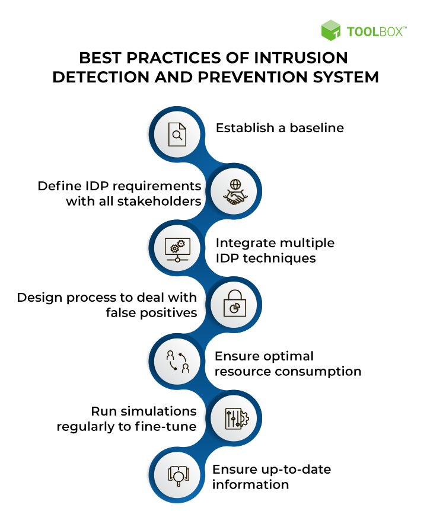

Figure 3 Best Practices of intrusion detection and preventaion system

To improve the efficiency of IDS solutions, organizations should follow best practices, including:

  - Updating Rules: Snort rule database is updated regularly to account for new emerging threats (Caswell & Beale, 2021).

  - Tactical deployment: Position Intrusion Detection Systems at the most sensitive points of entry to the network (data center and endpoints) to ensure maximum coverage (Hassan et al., 2023).

  - Integration with SIEM Systems: Correlate IDS logs with SIEM platforms to enhance threat analysis and response (Mohanakrishnan, 2022).

  - Encrypted communication Monitoring: Implement SSL decryption methods to enable Snort to scrutinize encrypted communication for concealed risks (Singh et al., 2022).

  - Perform regular social engineering penetration tests to evaluate the functionality of Intrusion Detection Systems (IDSs) and adjustment of detection thresholds (Rahman et al., 2021).

# 4.0 What is Snort?

Figure 4 snort logo

Snort is an IDS and IPS with its first version designed by Sourcefire and is currently sponsored by Cisco (Roesch, 1999). It monitors network packets in real-time for specific patterns and compares them to predefined rules and signatures in order to detect other known behaviors that are not normal activities.

  - Packet Sniffer Mode — Captures and presents network packets in real-time.

  - Packet Logger Mode — Records network traffic for subsequent study.

  - Network Intrusion Detection System (NIDS) — Observes traffic and identifies threats via an extensive set of rules.

Snort employs an attack signature-based detection mechanism where network traffic is inspected with known attack patterns in order to flag and detect hostile activity. The system also permits the set up of custom rules, enabling organizations to adjust their detection procedures to meet their specific security needs. (Roesch, 1999).

# 5.0 Why Use Snort Instead of Other IDS Tools?

Numerous IDS tools are available in the market, such as Suricata, Zeek (previously known as Bro), and OSSEC. Nonetheless, Snort continues to be a favored option for the following reasons:

1.  Open-Source and Complimentary — In contrast to most commercial IDS systems, Snort is available at no cost, rendering it accessible to companies of varying scales.

2.  Elevated Detection Precision - Snort’s extensive rule set allows it to identify a diverse array of cyber threats, encompassing malware infestations and intricate exploits.

3.  Flexibility and Customization — Security teams can establish their own protocols, enabling bespoke security measures that align with particular corporate requirements.

4.  Lightweight and Efficient — In contrast to resource-intensive IDS systems, Snort is built for performance and can be implemented across diverse network architectures with minimal overhead.

5.  Robust Community Support - With all the Cisco upgrades and an active open-source community, Snort receives regular updates to security rules to meet evolving danger indicators.

6.  Robust Community Support - With all the Cisco upgrades and an active open-source community, Snort receives regular updates to security rules to meet evolving danger indicators.

# 6.0 Install and configuration snort on snort

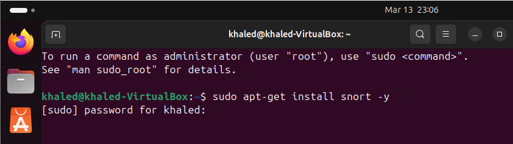

Figure 5: install snort

To use snort you have to install it first to do that u have to write Sudo to get the root permission after that write apt-get install snort -y

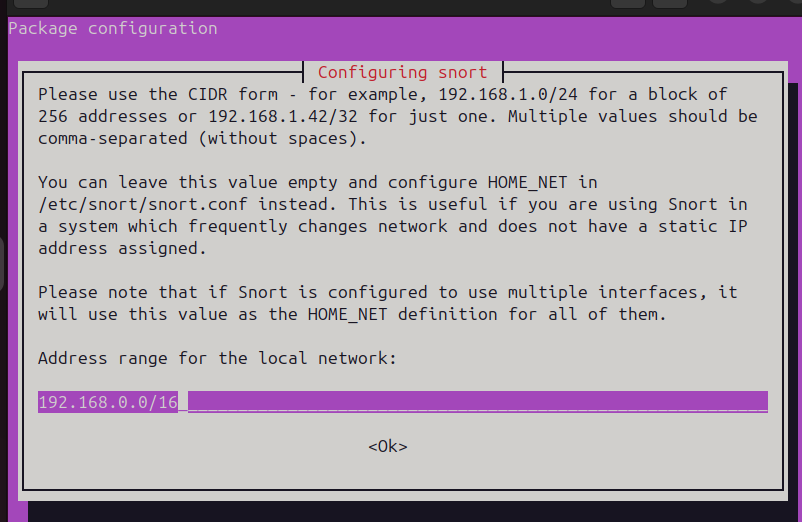

Figure 6: set up snort

After you run the command to install snort you will see this page it’s actually ask for the ip address for the device that you want to protect.

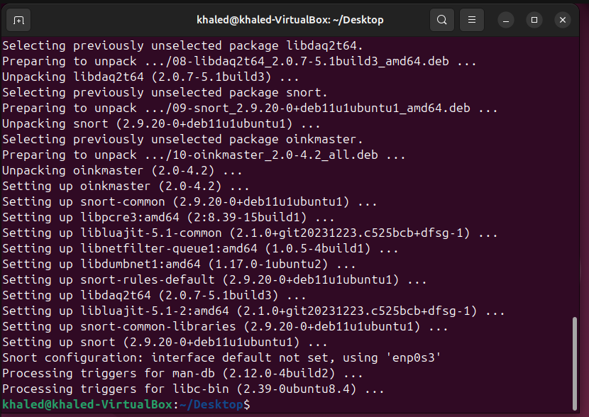

Figure 7: finithed install

Now as what we see we finished installing snort

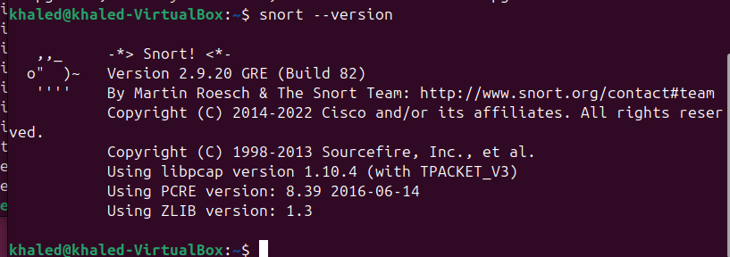

Figure 8: check

And now we what to check if snort really installed or not, we will write  
snort –version and as what we can see version 2.9.20 that’s mean we have installed snort

Figure 9: man snort

We run this command to do to the man (manual) command

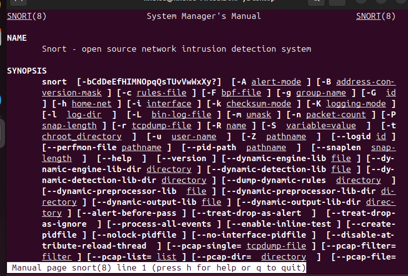

Figure 10: manual page

The man (manual) page that provides detailed information about commands, programs, system calls, and configuration files.

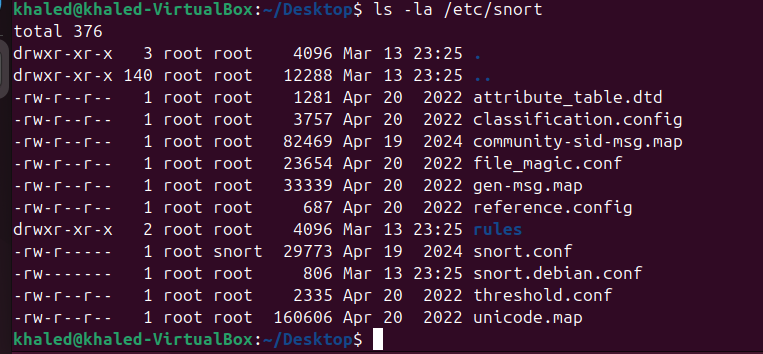

Figure 11: configuration

We type ls to display all the file in this directory

Figure 12: go to the main directory

And this command to go to the main directory to edit the snort system

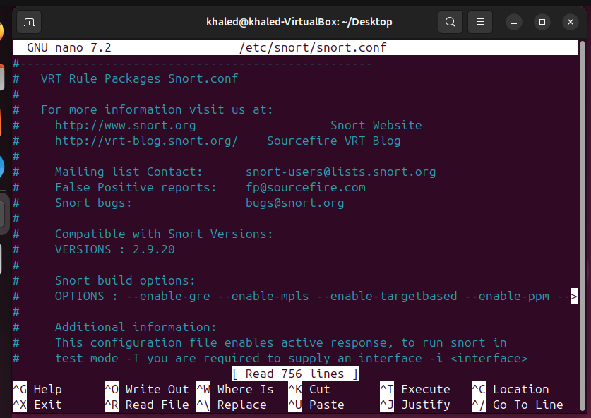

Figure 13: main snort file

After running the command we will see this file we want to go to change the Nat

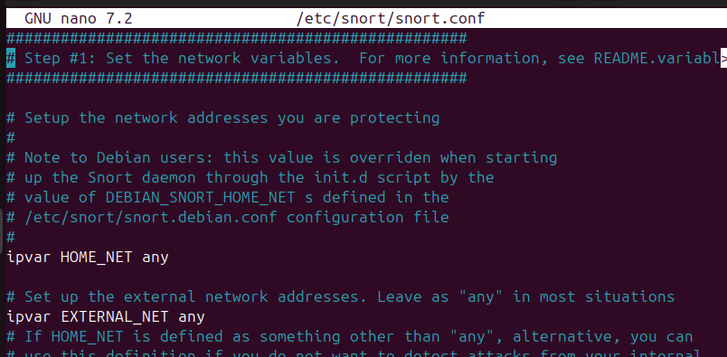

Figure 14: ip address

The variable **HOME\_NET** is set to **any**, meaning Snort will treat all network traffic as internal. Soo we will change any to our internal networks which is 192,168,26.0/24

And ipvar EXTERNAL\_NET any This defines external (untrusted) networks, typically representing the internet or outside traffic. Setting it to any means Snort will consider all networks outside

Figure 15: internal network

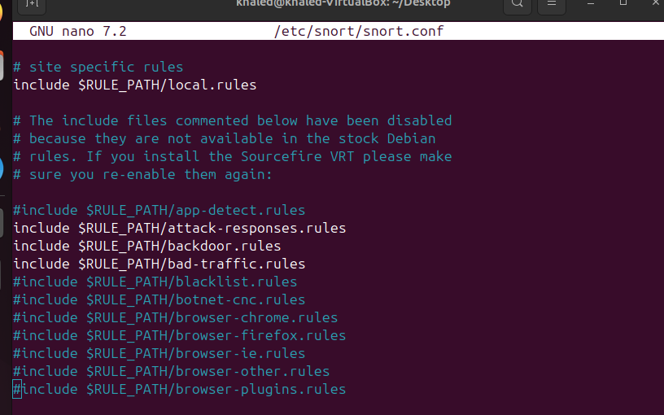

Figure 16: rules

And this is all the rules which is snort is looing for and I will comment all the rules from line 597 until 717 and I will keep just the local.rules why I’m doing, because all the rules that I commented it’s external rules that means I have to download each file if I don’t comment the rule and I don’t have the file rule it’s show me error message when I run the snort

> *Screenshot omitted from the public version (contains identifying information).*

Figure 17:local rule

Now after we finish configuring the main file of snort we will go to the rule file to add some rule that we want the snort to run on it

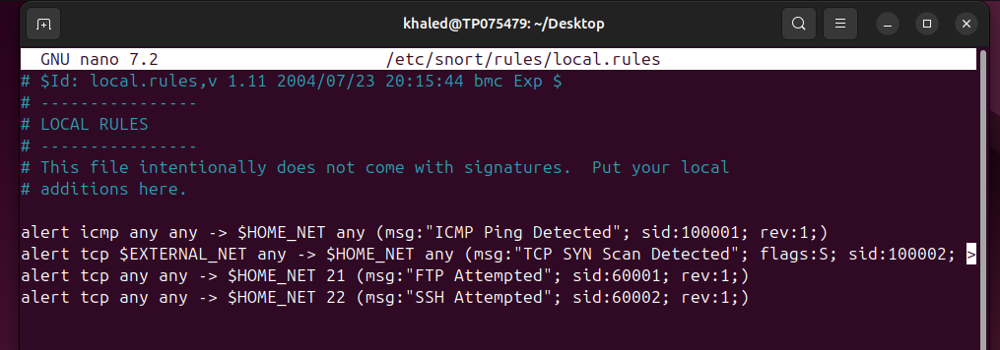

This Snort rule configuration local.rules defines custom intrusion detection rules to monitor suspicious network activities. It includes rules to detect ICMP pings, TCP SYN scans, FTP login attempts, and SSH login attempts. Each rule specifies the protocol, source and destination addresses, ports, and an alert message. The sid (Snort ID) uniquely identifies each rule, and rev (revision number) tracks rule updates. These rules help detect potential attacks on the internal HOME\_NET network.

## Running Snort

> *Screenshot omitted from the public version (contains identifying information).*

Figure 18: command to run snort

And to run snort we need to this command sudo snort -A console -c /etc/snort/snort.conf

  - **sudo** → Runs the command with **superuser privileges**, which is required for Snort to access network interfaces and configuration files.

  - **snort** → Executes the **Snort Intrusion Detection System (IDS)**.

  - **-A console** → Specifies **alert mode** as console, meaning all alerts will be displayed in the terminal.

  - **-c /etc/snort/snort.conf** → Tells Snort to **use the configuration file** located at /etc/snort/snort.conf.

After running the command we need to go to kali and try to ping to see if our snort works or not

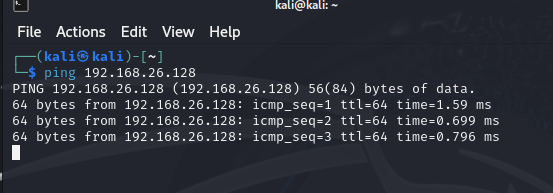

Figure 19: ping

We will use ping and after that the Ip for our device

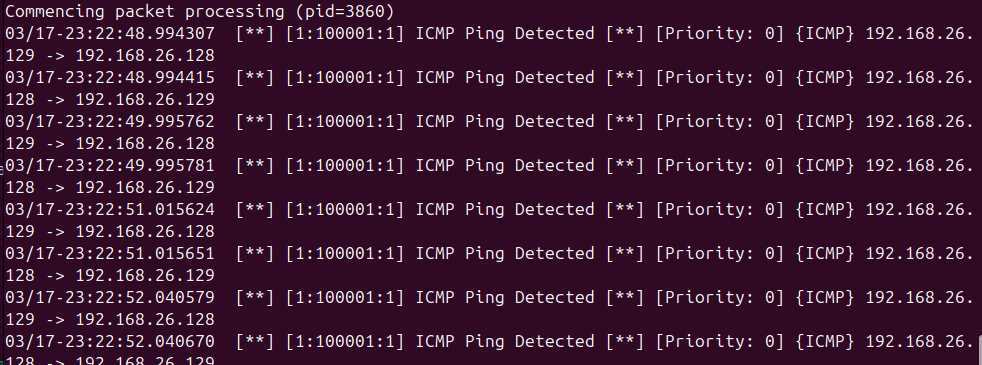

This output shows **Snort alerts** indicating that **ICMP ping traffic** has been detected. These alerts suggest that an **ICMP (ping) scan** is occurring on the network, which could be part of normal activity or a potential reconnaissance attempt by an attacker.

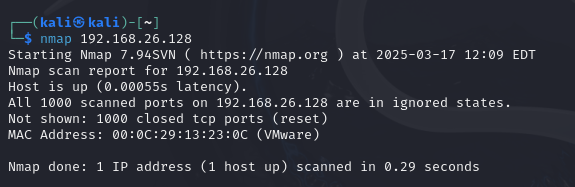

Figure 20: Nmap

And here we will use Nmap to scan open port

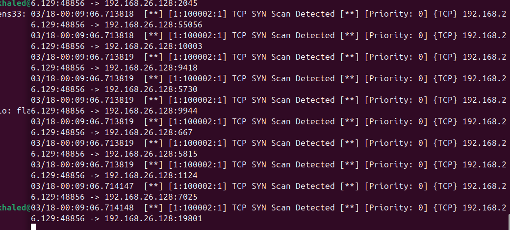

Figure 21: detected TCP SYN

This Snort alert log indicates **multiple TCP SYN scans** being detected. A **TCP SYN scan** is a type of network reconnaissance attack used by attackers or security professionals to **identify open ports on a target system**.

# 7.0 Conclusion

Without intrusion detection systems, which help identify and address network threats, an organization's cyber defense is rendered ineffective. For instance, Snort assists security teams in developing adaptable rules to address system threats instantly. It is ensured that ICMP ping sweeps, and unauthorized access attempts are captured during policy implementation for future analysis. An organization can monitor suspicious activity, immediately strengthen their defense posture, and enhance network security with the help of additional security measures.

# Refrences

Caswell, B., & Beale, J. (2004). *Snort 2.1 intrusion detection, second edition.* Syngress. https://www.syngress.com/snort-2-1-intrusion-detection

Mohanakrishnan, K. (2022). *Intrusion detection and prevention in cybersecurity.* Springer. <https://www.springer.com/gp/book/9783030964286>

Roesch, M. (1999). *Snort - Lightweight intrusion detection for networks.* Retrieved from <https://www.snort.org>

Scarfone, K., & Mell, P. (2007). *Guide to intrusion detection and prevention systems (IDPS).* NIST Special Publication 800-94. <https://nvlpubs.nist.gov/nistpubs/Legacy/SP/nistspecialpublication800-94.pdf>

Singh, A., Kumar, R., & Sharma, P. (2020). *Intrusion detection systems: Challenges and best practices.* *IEEE Transactions on Information Security.* <https://ieeexplore.ieee.org/document/9212523>

Vacca, J. (2013). *Computer and information security handbook.* Morgan Kaufmann. https://www.elsevier.com/books/computer-and-information-security-handbook/vacca/978-0-12-394397-2

Northcutt, S. (2005). *Network intrusion detection.* New Riders. https://www.pearson.com/us/higher-education/program/Northcutt-Network-Intrusion-Detection-3rd-Edition/PGM201744.html

Stallings, W. (2018). *Cryptography and network security: Principles and practice.* Pearson. https://www.pearson.com/store/p/cryptography-and-network-security-principles-and-practice/P100000647751

Bejtlich, R. (2004). *The tao of network security monitoring: Beyond intrusion detection.* Addison-Wesley. https://www.oreilly.com/library/view/the-tao-of/9780132702041/

Cheswick, W., Bellovin, S., & Rubin, A. (2003). *Firewalls and internet security: Repelling the wily hacker.* Addison-Wesley. https://www.pearson.com/us/higher-education/program/Cheswick-Firewalls-and-Internet-Security-Repelling-the-Wily-Hacker-2nd-Edition/PGM27395.html
